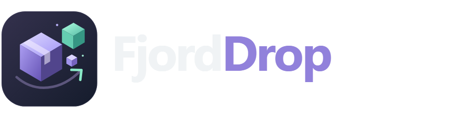

# FjordDrop



**Store filer. En lille genvej.** Selvhostet fildeling med krypterede WebRTC-forbindelser, delingslinks og monterede mapper. En del af FjordHub.

## Det kan appen

- Del en valgt mappe med et hemmeligt link, der udløber efter 1 time, 24 timer, 7 dage eller 30 dage.
- Modtageren ser filoversigten uden at oprette en konto, navigerer i undermapper og henter filer til sin pc.
- Tillad eventuelt upload tilbage til din destinationsmappe. Eksisterende filer overskrives aldrig.
- Åbn en anden FjordDrops delingslink inde i appen: **Hent til pc** eller **Gem på server**. Serveroverførslen fortsætter, selvom fanen lukkes.
- En lokal HTTP-instans kan parres **udad** med en offentlig HTTPS-instans. Modtagerens browser kommunikerer med HTTPS-instansen, mens filerne overføres til/fra den lokale filserver via WebRTC.
- 16 KiB bidder med indeks og SHA-256-kontrol; begrænsede vinduer og hukommelsesforbrug. Den komplette fil udgives først efter størrelseskontrol. WebRTC bruger DTLS/SCTP til kryptering og pålidelig transport.
- FjordHub-administratorlogin og SSO, CSRF-beskyttelse, udløb og tilbagekaldelse af links. Aktive forbindelser lukkes ved tilbagekaldelse.
- Dansk, responsiv brugerflade og komplet logo-/ikonpakke, inklusive PNG, SVG, ICO, PWA og socialkort.
- **Coturn installeres automatisk** som `fjorddrop-turn` sammen med appen. Hemmelig nøgle og tidsbegrænsede TURN-login oprettes automatisk; du skal ikke finde en ekstern TURN-tjeneste eller indtaste brugernavn/adgangskode.

Dette er en **peer-to-peer-filoverførsel mellem to endepunkter**, inspireret af torrents' bidder. Appen bruger ikke BitTorrent-trackere, magnetlinks eller multisource-swarming.

## Installer i FjordHub

Opdatér appkataloget og vælg **FjordDrop**. Vælg en ledig web-port (standard **8102**) og tre værtsmapper:

| Containersti | Indhold | Adgang |
| --- | --- | --- |
| `/data` | Delinger, indstillinger og parring | Læs/skriv |
| `/shared` | Biblioteket, du kan dele fra | Kun læsning |
| `/received` | Modtagne filer | Læs/skriv |

NAS/NFS/SMB skal først være monteret på Docker-værten. Vælg den monterede sti i installationsguiden. Giv den valgte UID/GID (standard 1000:1000) skriveadgang til appdata og destination og læseadgang til biblioteket. Brug separate mapper; del ikke system- eller appdatamapper. Symbolske links og skjulte filer vises ikke.

FjordHub udsteder appens login-nøgle ved installation. Åbn appen fra FjordHub, eller log ind med din administrator. Konti med påkrævet password-/mailændring skal først færdiggøres i Hub. Gæster bruger delingslinks og får aldrig adgang til administrationen.

Appens Compose bruger **host-netværk på Linux**, fordi ICE skal kunne åbne dynamiske UDP-porte. Der er ingen Docker-socket eller privilegeret container. Docker Desktop kræver aktiveret host-networking; Linux er den understøttede installationsvej. Andre apps påvirkes ikke af installation eller opdatering.

## HTTP hos den ene, HTTPS hos den anden

Der er to måder:

### Offentlig HTTPS-instans som mødested

1. Installer FjordDrop på en server med en offentlig HTTPS-adresse. Reverse proxy/tunnel skal understøtte WebSocket. Angiv adressen under **Forbindelse & mapper** og gem.
2. Vælg **Opret parringsnøgle** på den offentlige instans.
3. På den lokale HTTP-instans indtastes HTTPS-adressen, parrings-ID og parringsnøgle. Gem og vent på **Mødested: Online**.
4. Sørg for, at filafsenderens indbyggede TURN-server kan nås: videresend TCP+UDP 3478 og UDP 49160–49200 i router/firewall (eller de porte, du valgte ved installation).
5. Opret et delingslink i den lokale app. Linket peger automatisk på det offentlige mødested.

Den lokale instans forbinder udad med WSS og genopretter forbindelsen ved udfald. Den offentlige instans formidler filoversigt, rettighedskontrol og WebRTC-signaler. Selve filindholdet går mellem WebRTC-endepunkterne, eventuelt via et krypteret TURN-relæ. Mødestedet er **betroet infrastruktur**: det modtager delingsnøglen og metadata og serverer browserkoden. Brug et mødested, du stoler på.

En offentlig adresse er nødvendig for en modtager uden adgang til dit lokalnet. To isolerede private adresser kan ikke alene skabe et globalt delingslink.

### Hent fra en anden instans inde i appen

Vælg **Hent fra delingslink** og indsæt det komplette link inklusive `#adgangsnøgle`. Filoversigt og signalering sker fra serveren, så browserens mixed-content-regler ikke blokerer HTTPS → HTTP. Adressen skal være tilgængelig fra serveren. Et privat HTTP-link er kun til et netværk, som modtagerens server har adgang til; brug parring for internetdeling.

**Gem på server** går direkte til `/received/download-<id>/<filnavn>`. Upload fra en gæst gemmes i `/received/<deling>/<modtagelse>/<filnavn>`. Delte gæster kan ikke se `/received`, medmindre du udtrykkeligt deler en mappe derfra.

## STUN, TURN og kryptering

STUN hjælper med at finde direkte netværksruter. **TURN er nødvendigt, når NAT eller firewall forhindrer direkte kommunikation.** Begge funktioner følger nu med installationen. Compose bygger og starter Coturn, venter på en STUN-healthcheck og starter derefter appen. Det gælder både nye installationer og opdatering af eksisterende installationer gennem FjordHub.

Installationsguiden spørger kun om offentlig IPv4 og porte. Tom IPv4 opdages via HTTPS ved opstart; uden svar bruges lokal IP, og appen fortæller, at internetopsætningen mangler. Du kan angive `TURN_PUBLIC_IP` eksplicit. IP-adressen kontrolleres igen ved genstart; ved skiftende offentlig IP skal TURN-containeren genstartes. Ændring af værdier i `.env` kræver `docker compose up -d --force-recreate`.

Bag en router skal **TCP og UDP 3478** samt **UDP 49160–49200** videresendes uændret til Docker-værten. Samme porte skal være tilladt i værtsfirewallen. `TURN_PORT`, `TURN_MIN_PORT` og `TURN_MAX_PORT` kan tilpasses ved installation. En HTTPS-tunnel til webappen erstatter ikke disse portåbninger. CGNAT kan forhindre indgående trafik, selv når serveren har fundet en offentlig IP; brug da en offentlig TURN-instans. Ingen automatisk portåbning eller routerændring udføres af appen.

Coturn bruger UDP og TCP til klientforbindelser og UDP til relætrafik. Filindholdet er stadig krypteret af WebRTC/DTLS. Den medfølgende server har ikke TURN-over-TLS-certifikat; hvis et netværk kun tillader TLS-trafik, kan en ekstern TLS-TURN-server vælges under **Avanceret** (f.eks. `turns:turn.example.com:5349?transport=tcp`). Eksisterende eksterne TURN-indstillinger bevares ved opdatering. Tøm TURN-adressen for at bruge den indbyggede server igen.

Den fælles hemmelige nøgle oprettes én gang i Compose-volumen `turn-state` og monteres kun til læsning i appen. Browseren modtager et HMAC-baseret login, der udløber efter seks timer, aldrig serverens hemmelige nøgle. Coturn kræver autentifikation, har kvoter og blokerer relæadgang til loopback, private netværk, link-local og multicast. Opstartsprocessen klargør filrettigheder og sænker derefter privilegier til valgt PUID/PGID. Ved flere netkort kan `TURN_RELAY_IP` sættes eksplicit i `.env`.

Ingen universel forbindelse kan garanteres på netværk, der også blokerer TURN. Appen viser forbindelsesfejl og, hvor browserens statistik tillader det, **Direkte** eller **via TURN-relæ**. Filtrafikken er DTLS-krypteret i begge tilfælde. Browserens detektion af ruten kan variere. HTTPS beskytter signalering; lokal HTTP bør kun bruges på et betroet lokalnet. Filer på destinationens disk er almindelige filer, ikke krypteret af FjordDrop.

Midlertidige TURN-legitimationsoplysninger deles med autoriserede modtagere, så deres browser kan forbinde. Ved en ekstern TURN-server bruges dens konfigurerede konto. Delingsnøgler har 256 bits tilfældighed og lagres som hash; selve linket vises kun ved oprettelse. Browseren opbevarer nøglen for delingsfanen i sessionStorage, så genindlæsning virker. Undgå at dele linket offentligt.

## Pc-downloads og store filer

Chrome/Edge med File System Access API i en sikker browserkontekst (HTTPS eller localhost) kan skrive løbende til en valgt fil uden at holde hele filen i RAM. Browseren spørger om gemmested. Andre browsere/lokal HTTP bruger en Blob med en grænse på **256 MiB pr. fil**; større filer kan hentes via et HTTPS-link i Chrome/Edge eller med **Gem på server**. Upload og serverdownload har en konfigurerbar maksimumstørrelse, standard 100 GiB pr. fil.

Hold en browseroverførsel åben indtil den er færdig. Annullerede eller afbrudte overførsler skal startes forfra; automatisk genoptagelse fra en tidligere bid er ikke implementeret. Serverjobs overlever lukkede faner, men ikke en appgenstart. Der er maksimalt 16 indgående forbindelser og 2 samtidige udgående serverdownloads.

## Standalone

```sh
git clone https://github.com/qlerup/fjorddrop.git
cd fjorddrop
cp .env.example .env
# Tilpas stier, UID/GID og ADMIN_PASSWORD (mindst 16 tilfældige tegn).
mkdir -p /opt/fjorddrop/data /opt/fjorddrop/shared /opt/fjorddrop/received
sudo chown 1000:1000 /opt/fjorddrop/data /opt/fjorddrop/received
docker compose up -d --build
docker compose logs --tail=100 app
```

Åbn `http://server:8102`. Standalone-login bruger `ADMIN_PASSWORD`; brugernavnet er ikke relevant. Angiv HTTPS via din reverse proxy for offentlig adgang. Proxyen skal bevare `Host`, sætte `X-Forwarded-Proto` og tillade WebSocket på `/api/relay/`. API-svar og delingsvisninger har `no-store` og `no-referrer`. Indbyggede adgangslogs er slået fra for at undgå SSO-tokens i URL-logs; redigér også eventuelle reverse proxy-logs tilsvarende.

### Opdatering og backup

Opdatér gennem FjordHub eller med `git pull --ff-only && docker compose up -d --build`. Opdatering afbryder aktive forbindelser; eksisterende komplette filer bevares. Tag backup af `/data`, `/received` og `.env` samt selve biblioteket efter behov. Stop appen ved filkopiering af SQLite-databasen. Bevar indstillinger og parringsnøgler ved gendannelse. En tidligere commit kan bygges igen sammen med en kompatibel databasebackup.

Bevar også `turn-state`-volumen, som indeholder TURN-nøglen. Normalt `docker compose down` bevarer den; `down --volumes` sletter den og er ikke en almindelig opdateringskommando. En ny nøgle kan genereres ved frisk installation, men gamle TURN-login ophører da med at virke. Det kræver ikke ændring af delingslinks.

Efter et hårdt process-/strømsvigt kan skjulte `.partial*`-filer ligge i modtagelsesmapperne. De udgives ikke i filoversigten. Stop appen og gennemgå disse mapper før manuel oprydning. Normale afbrydelser og annullering rydder midlertidige filer op.

## Udvikling og test

```sh
python -m pip install -r requirements-dev.txt
python -m playwright install chromium
python -m pytest -q
python tests/browser_server.py
# I en anden terminal:
python tests/browser_check.py
python tools/build_brand.py
```

Browsertesten starter en lokal HTTPS-instans med et midlertidigt testcertifikat og en lokal HTTP-filserver. Den tester reel WSS-parring, binære WebRTC-downloads, upload tilbage, serverdownload, mobilbredder og konsolfejl. TLS-validering deaktiveres **kun i testbrowseren**; HTTP-filserveren stoler eksplicit på testcertifikatet. Produktionsklienten validerer almindelige CA-certifikater. CI tester også Docker-build og en non-root container med read-only root-filsystem. WAN-hastighed og TURN afhænger af den konkrete installation og skal verificeres dér.

Brandpakken findes i [`branding/`](branding/README.md). Ekstern browserkode: js-sha256 1.0.0 (MIT), vendoreret under `static/vendor` så hashing også virker ved lokal HTTP. Projektet er MIT-licenseret.

Protokolreferencer: [aiortc API](https://aiortc.readthedocs.io/en/stable/api.html) og [WebRTC data channels](https://developer.mozilla.org/en-US/docs/Web/API/WebRTC_API/Using_data_channels).
